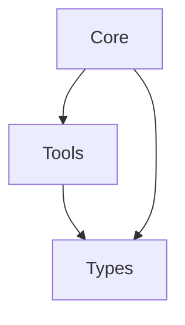

# Token Price Service

A Node.js/TypeScript/Nest.js application that demonstrates a token price update service with intentional anti-patterns and bugs.

## Project Overview

This service maintains information about various tokens (ERC20, Solana, etc.) in a single table in PostgreSQL. It periodically updates token prices from a mock service and sends price change messages to Kafka before saving to the database.

## Features

- Uses PostgreSQL for token data storage
- Uses Kafka as a message broker
- Includes Testcontainers for testing with PostgreSQL and Kafka in Docker containers
- Implements a denormalized database structure (intentional anti-pattern)
- Periodically updates token prices from a mock service
- Sends price update messages to Kafka

## Prerequisites

- Node.js (v18 or higher)
- Docker (for running tests with Testcontainers)
- PostgreSQL
- Kafka

## Running the Application

1. Make sure PostgreSQL is running on localhost:5432 with:
   - Database: tokens
   - Username: postgres
   - Password: postgres

2. Make sure Kafka is running on localhost:9092

3. Install dependencies:
   ```
   npm install
   ```

4. Run the application:
   ```
   npm start
   ```

## Running Tests

The integration tests use Testcontainers to spin up PostgreSQL and Kafka in Docker containers:

```
npm test
```


## Generate migrations

```
npm run migration:generate --name=YourMigrationName
```

## Project Structure

- **core**: Contains high abstraction business logic/flows
  - **core/[module-name]/entity**: data models
  - **core/[module-name]/services**: business logic implementation
  - **core/[module-name]/controllers**: nest controllers
- **tools**: Contains configs for external services
  - **tools/db/migrations**: Contains database migrations
  - **tools/kafka**: Contains kafka configuration
- **types**: Contains shared data types
- **test/**: Contains integration tests using Testcontainers


## Dependency flow
